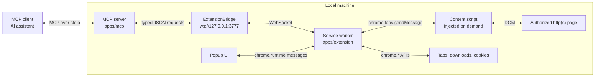
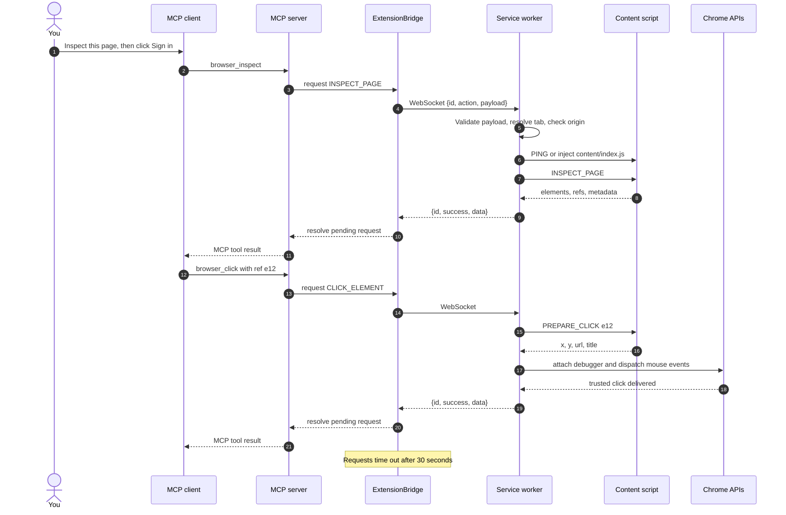
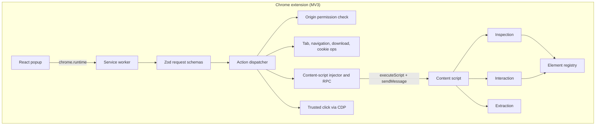
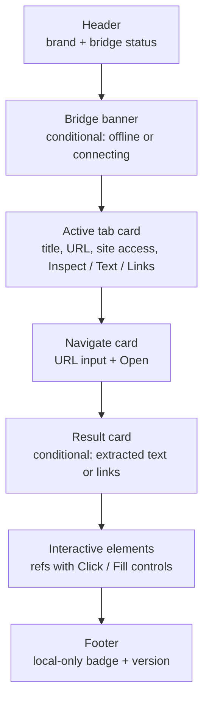
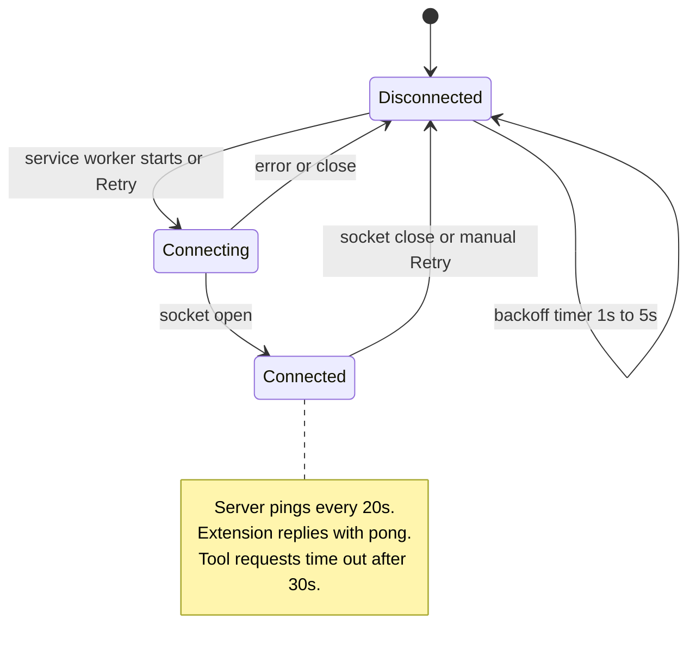
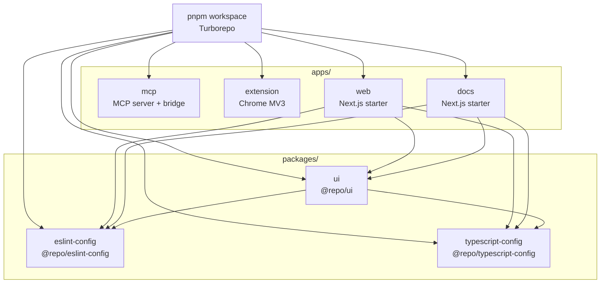
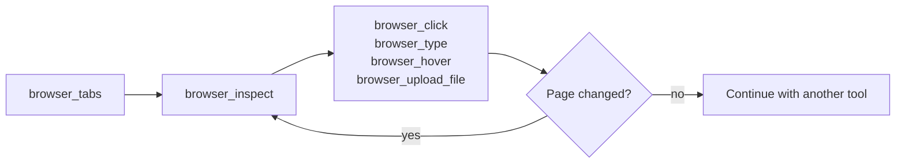
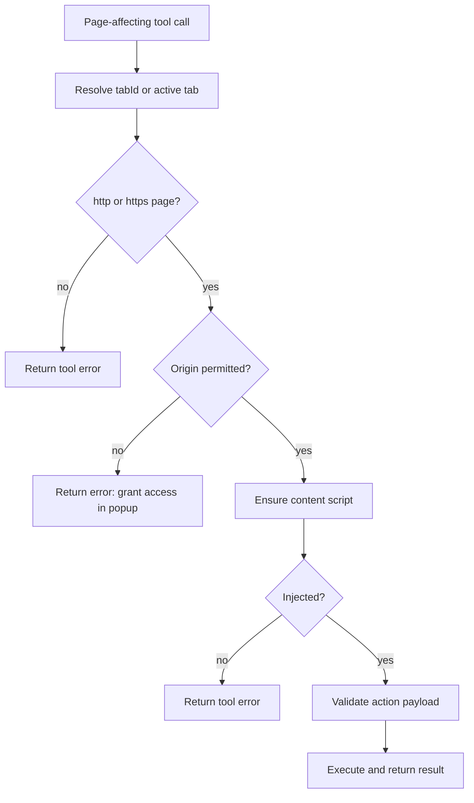

Agentium is a local-first bridge between an MCP client and your real Chrome browser. The MCP server exposes typed browser tools over stdio, and a Manifest V3 Chrome extension executes those actions in tabs you authorize.

There is no hosted browser, cloud relay, or remote session. The MCP server, the extension, and your pages all stay on your machine.

> [!WARNING]
> Browser tools can interact with signed-in websites and sensitive data. Grant site access only when needed, review actions with external effects, and run Agentium only on a machine you trust.

## Highlights

- **30 browser tools** for tabs, navigation, inspection, interaction, waiting, screenshots, downloads, cookies, and script evaluation.
- **Local-only transport** over stdio and a loopback WebSocket bridge.
- **Explicit site authorization** through Chrome permissions before page actions.
- **On-demand content-script injection** instead of running on every page.
- **Trusted clicks** dispatched through Chrome's debugger protocol.
- **Ephemeral element refs** that avoid brittle CSS selectors for normal interactions.
- **Validation at every process boundary** between the MCP server, extension, and page helper.

## Contents

- [System Design](#system-design)
- [Request Lifecycle](#request-lifecycle)
- [Extension Design](#extension-design)
- [Bridge Connection Lifecycle](#bridge-connection-lifecycle)
- [Repository Design](#repository-design)
- [Requirements](#requirements)
- [Setup](#setup)
- [Browser Tools](#browser-tools)
- [Permissions, Privacy, and Security](#permissions-privacy-and-security)
- [Development](#development)
- [Troubleshooting](#troubleshooting)
- [Repository Map](#repository-map)
- [Design Notes and Limitations](#design-notes-and-limitations)

## System Design

Agentium has four runtime layers: the MCP client, the local MCP server, the Chrome extension, and the web page being controlled.



| Layer           | Responsibility                                                                                                     | Key code                                                                                       |
| --------------- | ------------------------------------------------------------------------------------------------------------------ | ---------------------------------------------------------------------------------------------- |
| MCP client      | Starts the server, exposes Agentium tools to the AI assistant, and sends tool calls over stdio.                    | Client-owned                                                                                   |
| MCP server      | Registers tool schemas, validates arguments, forwards actions, and correlates replies.                             | [`apps/mcp/src/server.ts`](apps/mcp/src/server.ts)                                             |
| ExtensionBridge | Hosts the loopback WebSocket listener, tracks the extension connection, and enforces request timeouts.             | [`apps/mcp/src/bridge/extension-bridge.ts`](apps/mcp/src/bridge/extension-bridge.ts)           |
| Service worker  | Validates extension requests, checks site access, performs tab operations, and routes page actions.                | [`apps/extension/src/service-worker/execute.ts`](apps/extension/src/service-worker/execute.ts) |
| Content script  | Inspects and manipulates the DOM, tracks element refs, and returns page results.                                   | [`apps/extension/src/content/index.ts`](apps/extension/src/content/index.ts)                   |
| Popup           | Shows bridge status, requests site access, and offers manual inspect, extract, navigate, click, and fill controls. | [`apps/extension/src/popup/index.tsx`](apps/extension/src/popup/index.tsx)                     |

### Why a local WebSocket bridge?

An MCP client can launch the MCP server, but it cannot launch or directly message a Chrome extension. Chrome extensions can, however, open an outbound WebSocket. Agentium therefore inverts the connection:

1. The MCP client starts the server over stdio.
2. The server binds a WebSocket listener to `127.0.0.1:3777`.
3. The extension service worker connects to that listener.
4. MCP tool calls are forwarded over the existing socket, and replies are matched by request ID.

This keeps the browser bridge local and avoids exposing an inbound port on any external interface.

### Design principles

- **Validate at boundaries.** Tool arguments are validated with Zod, extension requests use a Zod discriminated union, and page requests are checked again inside the content script.
- **Least privilege by default.** The content script is injected only when a page action needs it. Page actions check the current origin before running.
- **Local trust, not remote access.** The bridge is bound to loopback and is intended for local MCP clients plus the extension.
- **Refs over selectors.** Normal interactions use short refs from the latest inspection instead of fragile CSS selectors.
- **Trusted input where it matters.** Clicks are dispatched through Chrome's debugger protocol rather than synthetic DOM events alone.
- **Keep stdout clean.** The MCP server writes diagnostics to stderr so stdout remains reserved for MCP protocol traffic.

## Request Lifecycle

The following sequence shows the standard inspect-then-click flow. Other tools follow the same request and response envelope.



### How element refs work

`browser_inspect` returns visible interactive elements with short refs such as `e12`.

- The content script registers each element in an `ElementRegistry` backed by a `Map` and `WeakMap`.
- Repeated inspections in the same page session reuse the ref for the same element.
- Refs become invalid after navigation, reload, or content-script reinjection.
- A ref can also become stale if the element is removed from the DOM. `resolve()` rejects unknown or disconnected elements with an instruction to inspect again.
- Clicks use the ref to locate the element, scroll it into view, calculate its center coordinates, and then dispatch trusted mouse events from the service worker.

Refs are intentionally not durable selectors. After a page update that changes the DOM, run `browser_inspect` again.

## Extension Design

The extension is an orchestration layer around Chrome APIs and an injected page helper.



### Service worker

[`apps/extension/src/service-worker/execute.ts`](apps/extension/src/service-worker/execute.ts) is the main dispatcher. It:

1. Validates the incoming message against [`shared/schemas.ts`](apps/extension/src/shared/schemas.ts).
2. Resolves the requested tab or falls back to the active tab.
3. Checks the current origin with `chrome.permissions.contains`.
4. Routes tab, navigation, download, and cookie operations to [`tabs.ts`](apps/extension/src/service-worker/tabs.ts).
5. Routes page operations through [`page-bridge.ts`](apps/extension/src/service-worker/page-bridge.ts).
6. Returns a standard success or error envelope.

### On-demand content script

The manifest does not declare a permanent content script. Before a page action, the service worker:

1. Sends a `PING` to the tab.
2. If there is no response, injects `content/index.js` with `chrome.scripting.executeScript`.
3. Sends another `PING` to confirm the helper is ready.
4. Forwards the page request with `chrome.tabs.sendMessage`.

This means the extension has no page footprint until an action actually needs one.

### Trusted clicks

A click has two phases:

- The content script resolves the ref, checks visibility and disabled state, scrolls the element into view, and returns its viewport coordinates.
- The service worker attaches `chrome.debugger` and sends CDP `Input.dispatchMouseEvent` messages for mouse movement, press, and release, then detaches.

The content script never dispatches the final click itself. This produces trusted input events for sites that ignore synthetic clicks.

### Popup UI

The popup is a React app that talks to the service worker through `chrome.runtime` messages. It polls bridge status while open and exposes manual controls for common tasks.



## Bridge Connection Lifecycle

The MCP server and extension maintain a single long-lived WebSocket connection. The extension reconnects automatically if Chrome suspends its service worker or the server restarts.



Connection behavior:

- The server accepts a new extension connection, replacing any previous one. Pending requests from the old connection are rejected.
- The server rejects connections whose browser origin is present but is not a `chrome-extension://` origin.
- The extension reconnect delay starts at 1 second, doubles up to 5 seconds, and is backed by a Chrome alarm so reconnection can survive service-worker suspension.
- The toolbar badge shows `ON` when connected, `...` while connecting, and a warning color when offline.
- The popup polls bridge status every 1.5 seconds while it is open.
- Only one MCP server can own port `3777`. A second instance fails to start.

## Repository Design

Agentium is a pnpm workspace orchestrated by Turborepo.



| Workspace                    | Package                      | Purpose                                                                |
| ---------------------------- | ---------------------------- | ---------------------------------------------------------------------- |
| `apps/mcp`                   | `agentium-mcp` (npm)         | stdio MCP server, tool schemas, and local WebSocket bridge.            |
| `apps/extension`             | `@Agentium/extension`        | Chrome MV3 service worker, popup, content script, and browser actions. |
| `apps/web`                   | `web`                        | Next.js starter app. Not required to run the browser bridge.           |
| `apps/docs`                  | `docs`                       | Next.js starter app. Not required to run the browser bridge.           |
| `packages/ui`                | `@repo/ui`                   | Shared React components used by the Next.js apps.                      |
| `packages/eslint-config`     | `@repo/eslint-config`        | Shared ESLint configuration.                                           |
| `packages/typescript-config` | `@repo/typescript-config`    | Shared TypeScript configuration.                                       |

## Requirements

| Requirement        | Version                                                                    |
| ------------------ | -------------------------------------------------------------------------- |
| Node.js            | `>=22.13`                                                                  |
| pnpm               | `11.25.0` (declared in the root `package.json`)                            |
| Chrome or Chromium | Manifest V3 support; the extension manifest requires Chrome `116` or newer |

## Setup

### 1. Install dependencies

From the repository root:

```sh
pnpm install
```

### 2. Build the bridge components

```sh
pnpm --dir apps/mcp run build
pnpm --dir apps/extension run build
```

The MCP server is written to `apps/mcp/dist`. The loadable extension is written to `apps/extension/dist`.

### 3. Load the extension

1. Open `chrome://extensions`.
2. Turn on **Developer mode**.
3. Choose **Load unpacked** and select `apps/extension/dist`.
4. Open the Agentium popup. If the bridge is offline, select **Retry** after the MCP server is running.

After rebuilding the extension, reload it from `chrome://extensions`. Refresh affected tabs so the new content script can be injected.

### 4. Configure an MCP client

Install the MCP server from npm (no local build required):

```bash
npx -y agentium-mcp
```

Then configure your MCP client to run it as an stdio server:

```json
{
  "mcpServers": {
    "agentium": {
      "command": "npx",
      "args": ["-y", "agentium-mcp"]
    }
  }
}
```

The server binds a loopback listener to `ws://127.0.0.1:3777` and waits for your Agentium Chrome Extension to connect.

Alternatively, to run from a local checkout instead of npm:

```json
{
  "mcpServers": {
    "agentium": {
      "command": "node",
      "args": ["/absolute/path/to/Agentium/apps/mcp/dist/index.js"]
    }
  }
}
```

Replace the example path with the absolute path to this checkout. On Windows, escape backslashes in the JSON path, for example `C:\\path\\to\\Agentium\\apps\\mcp\\dist\\index.js`.

### 5. Verify the connection

Use a tool such as `browser_tabs` in the MCP client. It should return the open tabs. Then navigate to a normal `http` or `https` page and run `browser_inspect`.

### Development mode

Run the MCP server directly:

```sh
pnpm --dir apps/mcp run dev
```

Use watch mode when editing the server:

```sh
pnpm --dir apps/mcp run dev:watch
```

Watch and rebuild the extension:

```sh
pnpm --dir apps/extension run dev
```

After an extension rebuild, reload the unpacked extension in Chrome. Existing tabs may need a refresh before the updated content script is available.

## Browser Tools

Unless a tool specifically requires a tab ID, `tabId` is optional. When it is omitted, the active tab is used. Get tab IDs from `browser_tabs` first when the user refers to a specific tab or window.

### Recommended workflow



A reliable interaction loop is:

1. Call `browser_tabs` to identify the target tab.
2. Call `browser_inspect` to obtain element refs.
3. Use `browser_click`, `browser_type`, `browser_hover`, or `browser_upload_file` with a ref.
4. Inspect again after navigation, reload, or any page update that changes the DOM.

### Tabs and navigation

| Tool                       | What it does                                                                                                |
| -------------------------- | ----------------------------------------------------------------------------------------------------------- |
| `browser_tabs`             | Lists open tabs with IDs, titles, URLs, active state, and window IDs.                                       |
| `browser_open_tab`         | Opens a new tab at an absolute `http` or `https` URL and waits for it to load. `active` defaults to `true`. |
| `browser_switch_tab`       | Brings a tab and its window to the foreground. Requires `tabId`.                                            |
| `browser_close_tab`        | Closes a tab. Requires `tabId`. Closing the last tab may close its window.                                  |
| `browser_navigate`         | Navigates a tab to an absolute URL and waits for the page to load.                                          |
| `browser_back`             | Goes backward in the tab's history.                                                                         |
| `browser_forward`          | Goes forward in the tab's history.                                                                          |
| `browser_reload`           | Reloads the page and waits for completion.                                                                  |
| `browser_stop_loading`     | Stops the page from loading further.                                                                        |
| `browser_navigation_state` | Returns the current URL, pending URL, title, and loading status.                                            |

### Page inspection and extraction

| Tool                     | What it does                                                                                                                                                                 |
| ------------------------ | ---------------------------------------------------------------------------------------------------------------------------------------------------------------------------- |
| `browser_inspect`        | Returns a compact list of visible interactive elements, headings, and forms with refs, kinds, accessible names, and related metadata. Defaults to 120 elements; maximum 300. |
| `browser_extract`        | Reads readable text or unique links from the page. Text defaults to 8,000 characters; links default to 100 items.                                                            |
| `browser_find_by_text`   | Searches page text with substring or exact matching. Defaults to 10 matches; maximum 50. Returns best-effort tag selectors, not interactive refs.                            |
| `browser_get_page_state` | Returns URL, title, `document.readyState`, viewport size, and whether the page is interactive.                                                                               |

### Interaction

| Tool                    | What it does                                                                                                                                                       |
| ----------------------- | ------------------------------------------------------------------------------------------------------------------------------------------------------------------ |
| `browser_click`         | Clicks an inspected ref using trusted Chrome debugger input.                                                                                                       |
| `browser_type`          | Fills an input, textarea, or content-editable element by ref. Set `submit` to press Enter or submit the form afterward.                                            |
| `browser_fill_form`     | Fills up to 50 fields by CSS selector, with optional clear and submit flags. Use this when selectors are known; use refs for normal inspection-driven interaction. |
| `browser_upload_file`   | Sets a file input by ref using base64 content and optional MIME type. The base64 payload is limited to 5,000,000 characters.                                       |
| `browser_hover`         | Dispatches hover events over a ref and returns the target coordinates.                                                                                             |
| `browser_scroll`        | Scrolls to coordinates or in a direction (`top`, `bottom`, `up`, `down`, `left`, `right`) with `auto` or `smooth` behavior.                                        |
| `browser_handle_dialog` | Installs a page-helper handler for `alert`, `confirm`, or `prompt` dialogs so they can be accepted or dismissed. Use it before triggering the modal.               |

### Waiting

| Tool                            | What it does                                                                                                                                                                              |
| ------------------------------- | ----------------------------------------------------------------------------------------------------------------------------------------------------------------------------------------- |
| `browser_wait_for_selector`     | Waits for a CSS selector to appear, optionally requiring visibility. Defaults to 10 seconds.                                                                                              |
| `browser_wait_for_url`          | Waits until the tab URL contains a substring. Defaults to 15 seconds.                                                                                                                     |
| `browser_wait_for_network_idle` | Waits until the page has been stable for a short window. Despite the name, it watches DOM mutations rather than network requests. Defaults to a 15-second timeout and 500 ms idle window. |

### Screenshots

| Tool                 | What it does                                                                                                                          |
| -------------------- | ------------------------------------------------------------------------------------------------------------------------------------- |
| `browser_screenshot` | Captures the visible viewport as a JPEG data URL. The `fullPage` flag is accepted for compatibility but is not currently implemented. |

### Downloads and cookies

| Tool                     | What it does                                                                                                           |
| ------------------------ | ---------------------------------------------------------------------------------------------------------------------- |
| `browser_download_file`  | Starts an `http` or `https` download and returns the Chrome download ID. Supports a filename and optional save dialog. |
| `browser_downloads_list` | Lists recent downloads with state, bytes, MIME type, and timing. Defaults to 25 items; maximum 100.                    |
| `browser_get_cookies`    | Lists cookies for the selected tab's site or a supplied URL.                                                           |
| `browser_set_cookie`     | Sets a cookie with optional path, domain, secure, httpOnly, SameSite, and expiry fields.                               |

### Script evaluation

| Tool                  | What it does                                                                                                                                                                                                                 |
| --------------------- | ---------------------------------------------------------------------------------------------------------------------------------------------------------------------------------------------------------------------------- |
| `browser_evaluate_js` | Evaluates a JavaScript expression in the injected content script and returns a JSON-safe result. Scripts are limited to 50,000 characters. This is a powerful escape hatch; prefer the typed tools when they cover the task. |

### Defaults and limits

| Setting                   | Default    | Maximum                     |
| ------------------------- | ---------- | --------------------------- |
| Elements per inspection   | 120        | 300                         |
| Extracted text characters | 8,000      | 50,000                      |
| Extracted links           | 100        | 500                         |
| Text search matches       | 10         | 50                          |
| Selector wait             | 10 seconds | 60 seconds                  |
| URL wait                  | 15 seconds | 60 seconds                  |
| Network-idle timeout      | 15 seconds | 60 seconds                  |
| Downloads returned        | 25         | 100                         |
| Upload payload            | —          | 5,000,000 base64 characters |
| Bridge request timeout    | 30 seconds | Fixed                       |

## Permissions, Privacy, and Security

### Authorization flow

Page actions are gated by tab resolution, URL scheme checks, and Chrome origin permissions.



Tab listing, switching, closing, history, and loading controls do not require a page origin check. Navigation and new-tab creation check the target URL's origin. Page operations require the resolved tab's origin. Chrome-internal pages such as `chrome://settings` cannot be controlled.

### Manifest permissions

The extension manifest requests the following capabilities:

| Permission                                            | Use                                                                                                          |
| ----------------------------------------------------- | ------------------------------------------------------------------------------------------------------------ |
| `tabs`                                                | List, inspect, focus, create, and close tabs.                                                                |
| `scripting`                                           | Inject the content script and stop page loading.                                                             |
| `alarms`                                              | Keep bridge reconnection alive across service-worker suspension.                                             |
| `downloads`                                           | Start and list downloads.                                                                                    |
| `cookies`                                             | Read and write cookies for the selected site.                                                                |
| `debugger`                                            | Dispatch trusted click input through CDP.                                                                    |
| `storage`, `webNavigation`, `notifications`           | Declared extension capabilities. The core bridge flow does not currently depend on them.                     |
| `host_permissions` for `http://*/*` and `https://*/*` | Declare access to normal web pages. Runtime checks still restrict page actions to the resolved tab's origin. |

Review [`apps/extension/src/manifest.json`](apps/extension/src/manifest.json) before installing or modifying the extension.

### Data handling

- Inspection returns visible interactive elements and their accessible names.
- Input values are omitted for password and file inputs, and for input elements whose autocomplete value matches password, one-time-code, or payment-card patterns.
- Other field values, page text, links, cookies, and script results can contain sensitive data. The redaction rules are not a sandbox.
- Tool results are returned to the MCP client. Treat them according to the client's privacy and retention settings.
- Agentium does not send browser data to a hosted service.

### Security boundaries

- The WebSocket bridge binds only to `127.0.0.1:3777`.
- The bridge is a local trust boundary, not an authentication boundary. It rejects browser connections whose `Origin` is present and is not `chrome-extension://...`, but any local process that can reach the port and speak the protocol may be able to act through the extension. Run only trusted software and never expose the port.
- The `debugger` permission is powerful. Only use Agentium with extensions and browser profiles you control.
- `browser_evaluate_js` runs in the injected content script's context. It can read and modify the page DOM and is not a security sandbox.
- Actions with external effects include form submissions, purchases, messages, downloads, cookie changes, and account changes. Confirm consequential actions with the user before performing them.

## Development

### Root commands

| Command            | Purpose                                                |
| ------------------ | ------------------------------------------------------ |
| `pnpm install`     | Install workspace dependencies.                        |
| `pnpm build`       | Build all workspaces through Turborepo.                |
| `pnpm dev`         | Run development tasks for all workspaces.              |
| `pnpm lint`        | Run lint tasks that are defined by workspace packages. |
| `pnpm check-types` | Typecheck all workspaces through Turborepo.            |
| `pnpm format`      | Format TypeScript, TSX, and Markdown with Prettier.    |

### MCP server commands

```sh
pnpm --dir apps/mcp run dev        # tsx src/index.ts
pnpm --dir apps/mcp run dev:watch  # restart on changes
pnpm --dir apps/mcp run build      # tsc to dist
pnpm --dir apps/mcp run check-types
pnpm --dir apps/mcp run start      # node dist/index.js
```

### Extension commands

```sh
pnpm --dir apps/extension run build        # esbuild + static assets to dist
pnpm --dir apps/extension run dev          # watch mode
pnpm --dir apps/extension run check-types
```

The extension build bundles the service worker as ESM, the content script as an IIFE, and the popup as an IIFE, then copies the manifest, icons, HTML, and CSS into `apps/extension/dist`.

### Verification checklist

There is no automated test suite in the workspace yet. Before submitting a change, run the relevant build and typecheck commands and verify the browser flow manually:

1. Start the MCP server and confirm the popup shows **Connected**.
2. Run `browser_tabs` and verify the tab list.
3. Run `browser_inspect` on a normal `https` page.
4. Click or fill an element using a returned ref.
5. Extract page text and links.
6. Reload the unpacked extension after any extension rebuild.

## Troubleshooting

| Symptom                                         | Check                                                                                                                                            |
| ----------------------------------------------- | ------------------------------------------------------------------------------------------------------------------------------------------------ |
| Extension says MCP is disconnected              | Start the MCP server, check that port `3777` is free, open the popup, and select **Retry**. Only one server instance should use the bridge port. |
| A page action says access is missing            | Open the popup on that site and grant access. Chrome-internal pages cannot be controlled.                                                        |
| A ref is unknown or stale                       | Run `browser_inspect` again and use a newly returned ref. Refs do not survive navigation or reload.                                              |
| The content script does not respond             | Reload the page and retry. Some pages, internal URLs, and restricted frames cannot receive injected scripts.                                     |
| The extension does not reflect a new build      | Rebuild, reload `apps/extension/dist` from `chrome://extensions`, and refresh affected tabs.                                                     |
| MCP server fails to start                       | Check the Node.js version and confirm no other Agentium process is using port `3777`.                                                            |
| Trusted clicks fail                             | Check whether another debugger is attached to the tab, including DevTools. The service worker must be able to attach `chrome.debugger`.          |
| Screenshot is only the viewport                 | This is expected. `fullPage` is accepted but not implemented yet.                                                                                |
| Network-idle wait returns too early or too late | It observes DOM mutation idle, not actual network activity. Adjust `idleMs` or use `browser_wait_for_selector` / `browser_wait_for_url`.         |

## Repository Map

### Entrypoints and design

- [MCP process entrypoint](apps/mcp/src/index.ts)
- [MCP tool registration](apps/mcp/src/server.ts)
- [MCP-to-extension WebSocket bridge](apps/mcp/src/bridge/extension-bridge.ts)
- [Bridge action and response types](apps/mcp/src/bridge/types.ts)
- [Extension manifest](apps/extension/src/manifest.json)
- [Extension build script](apps/extension/build.mjs)
- [Service worker entrypoint](apps/extension/src/service-worker/index.ts)
- [Extension action dispatcher](apps/extension/src/service-worker/execute.ts)
- [Content-script injector and RPC](apps/extension/src/service-worker/page-bridge.ts)
- [Site permission checks](apps/extension/src/service-worker/permissions.ts)
- [Tab, download, and cookie operations](apps/extension/src/service-worker/tabs.ts)
- [Trusted click implementation](apps/extension/src/service-worker/trusted-click.ts)
- [Popup UI](apps/extension/src/popup/index.tsx)
- [Content-script entrypoint](apps/extension/src/content/index.ts)
- [Page inspection](apps/extension/src/content/inspection.ts)
- [Page interaction handlers](apps/extension/src/content/interaction.ts)
- [Page extraction](apps/extension/src/content/extraction.ts)
- [Element ref registry](apps/extension/src/content/refs.ts)
- [Page request validation](apps/extension/src/content/validation.ts)
- [Shared extension protocol](apps/extension/src/shared/protocol.ts)
- [Shared extension schemas](apps/extension/src/shared/schemas.ts)
- [Bridge status helpers](apps/extension/src/shared/bridge-status.ts)

### Configuration

- [Root package and scripts](package.json)
- [pnpm workspace definition](pnpm-workspace.yaml)
- [Turborepo pipeline](turbo.json)
- [Web app](apps/web)
- [Docs app](apps/docs)
- [Shared UI package](packages/ui)
- [Shared ESLint config](packages/eslint-config)
- [Shared TypeScript config](packages/typescript-config)

## Design Notes and Limitations

- **Refs are ephemeral.** They are scoped to the content-script instance and the current DOM. Reinspect after page changes.
- **Screenshots are viewport-only.** `browser_screenshot` currently ignores `fullPage`.
- **Network-idle is DOM-idle.** `browser_wait_for_network_idle` uses a `MutationObserver`, not the Network panel or the Resource Timing API.
- **Clicks require debugger access.** `browser_click` attaches `chrome.debugger` for each trusted click. Another debugger client can prevent attachment.
- **Dialog handling is helper-side.** `browser_handle_dialog` overrides `alert`, `confirm`, and `prompt` in the injected helper. Verify site-specific behavior before relying on it for blocking modals.
- **One extension connection at a time.** A new extension connection replaces the previous one and fails requests that were still pending.
- **One MCP server per port.** The bridge cannot share port `3777` with another Agentium process.
- **No request cancellation.** Bridge requests time out after 30 seconds; in-flight page operations are not explicitly cancelled.
- **Chrome-internal pages and restricted frames are out of scope.** Agentium is limited to normal `http` and `https` pages.
- **The web and docs apps are starter scaffolds.** They are part of the monorepo but are not required for the browser bridge.
- **No automated tests yet.** Use build, typecheck, and manual Chrome verification.

## Contributing

Keep browser access explicit and predictable:

- Validate messages at every process boundary.
- Keep MCP stdout reserved for protocol traffic and write diagnostics to stderr.
- Prefer refs for inspection-driven interaction and avoid logging page content.
- Do not add remote listeners or cloud relays to the local bridge.
- Build and typecheck the workspaces you touch, then verify the corresponding browser flow in Chrome.

When adding a browser tool, update the MCP schema, the bridge action types, the extension request schema, the service-worker dispatcher, the content-script handler, and this README together.
